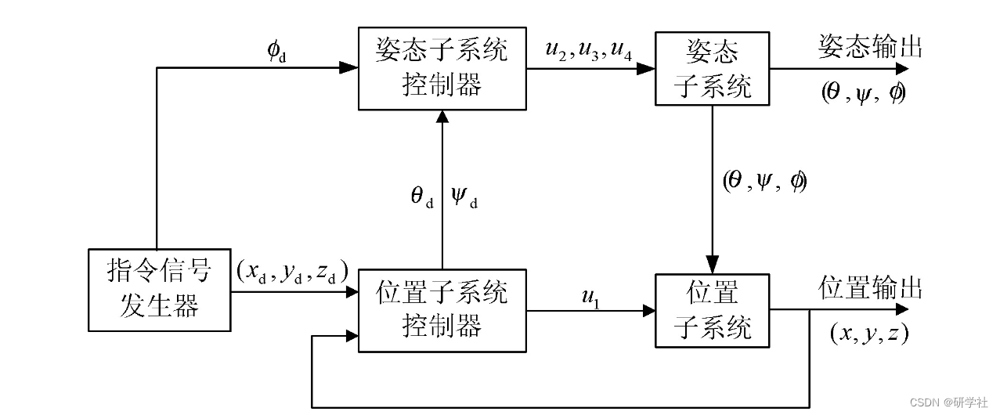
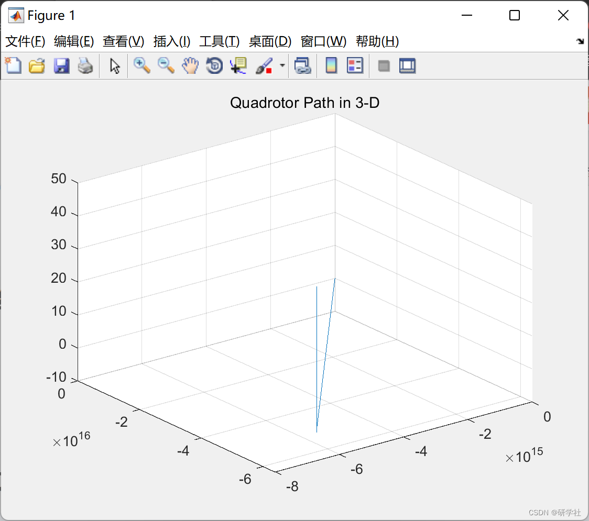
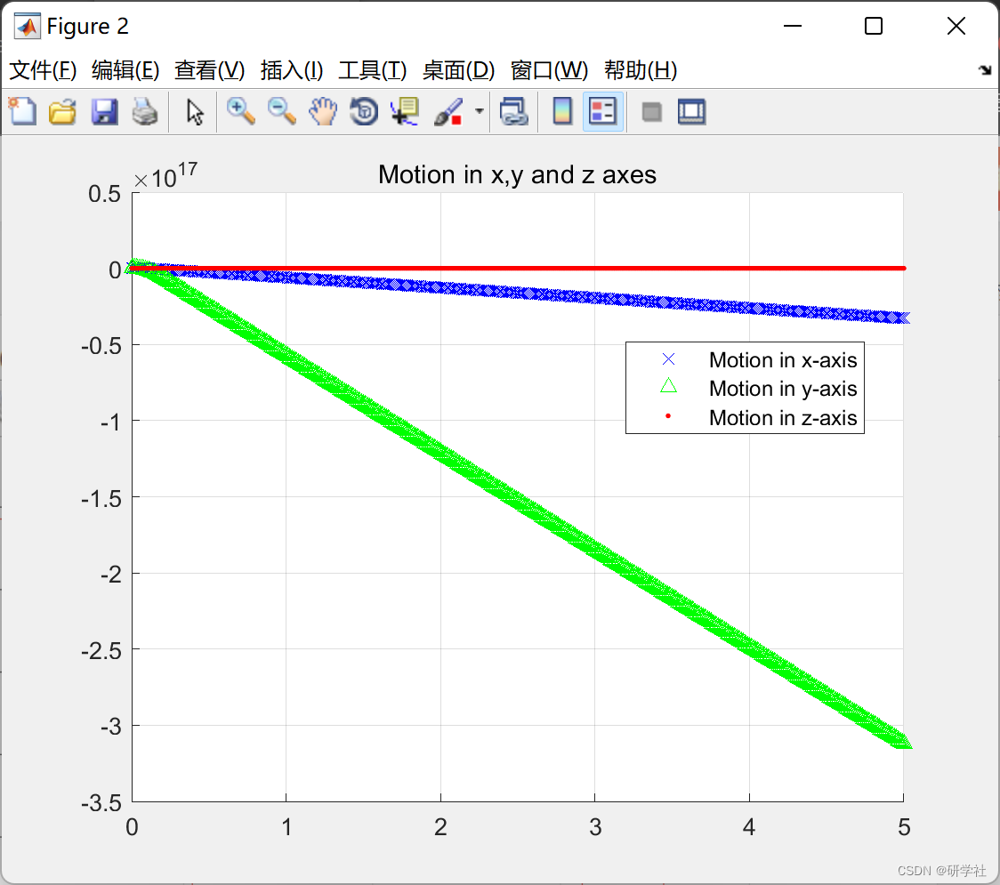
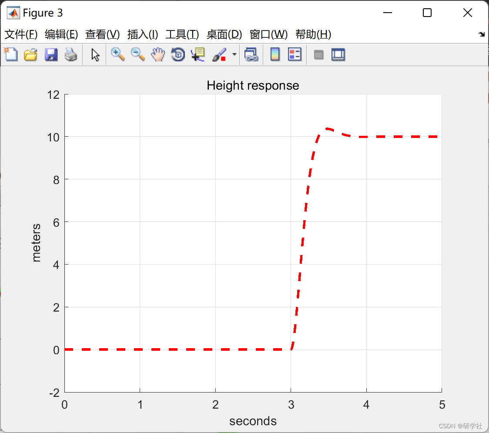
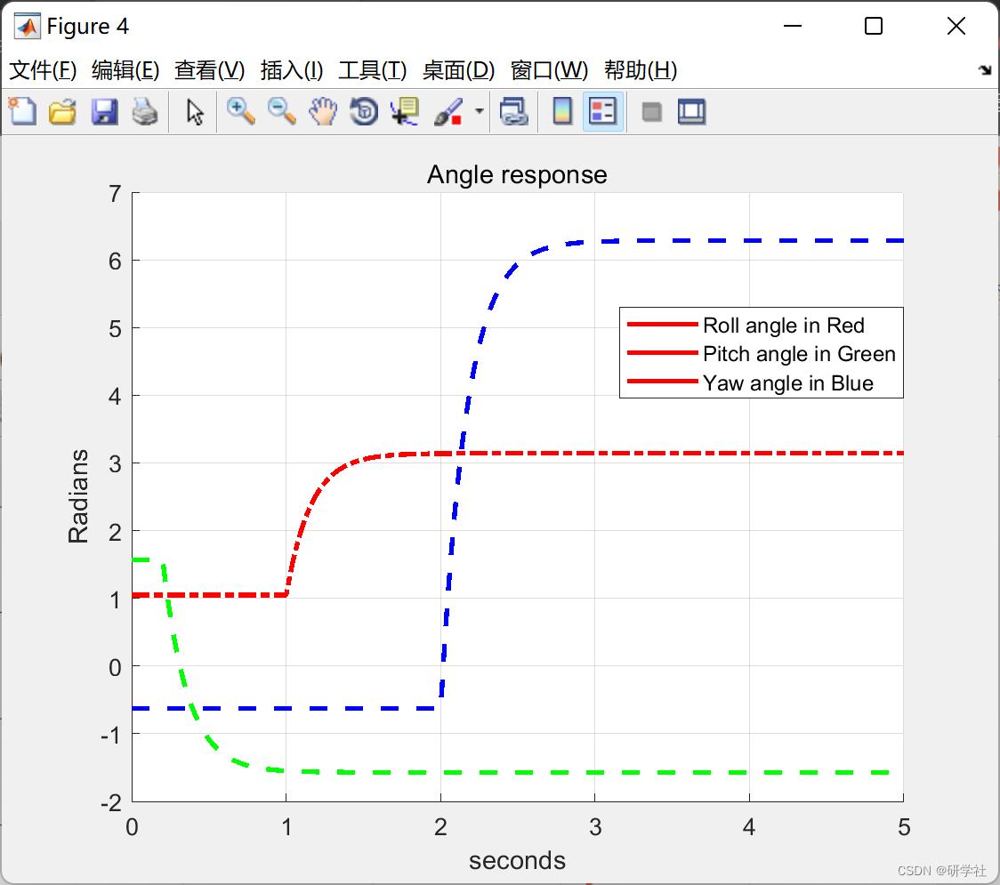
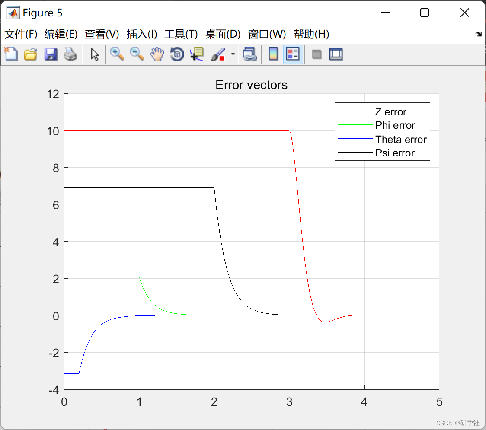
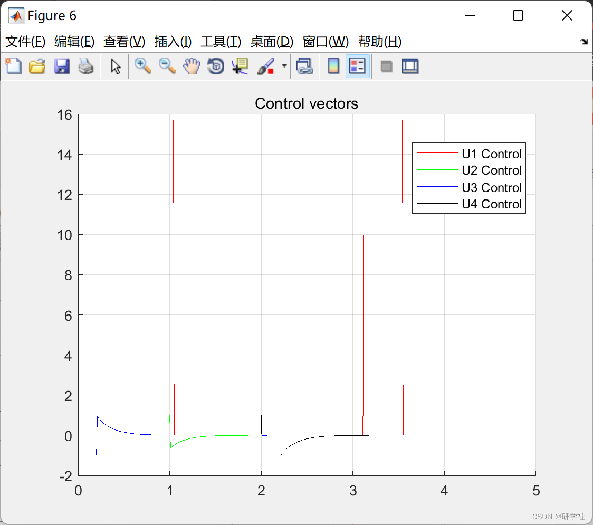

# Research on PD control based on quadrotor drone (implemented in Matlab)

💥💥💞💞 Welcome to this blog❤️❤️ 💥💥
🏆 Bloggers' Advantages: 🌞🌞🌞 The content of the blog strives for rigorous thinking and clear logic to facilitate readers.
⛳️ Mantra: A journey of a thousand miles is begun with a single step. Table of Contents 💥1 Overview📚2 Run Results🎉3 References 🌈4 MATLAB Code Implementation
💥1 Overview In recent years, UAVs (Unmanned Aerial Vehicles) have increasingly been applied in civilian fields such as environmental protection, power generation, transportation, surveying, security, agriculture, etc. With the advancement of modern technology, especially the rapid development of artificial intelligence technology, the future application model of drone + industry holds broad prospects. Currently, the level of intelligence of drones still needs to be improved, and many applications are controlled by drone operators. To enhance the automation and intelligence level of drones, extensive research by researchers is necessary. The problem of autonomous landing for drones is a key technical issue that must be resolved in the intelligent application of drones. Compared to drone flight planning and navigation, research on autonomous landing is relatively scarce.
Four-rotor UAV dynamics model
A four-rotor UAV is a MIMO system, and its dynamics model can be represented as (the formula is important):
In the formula: (x.y.z) represents the position of the UAV's centroid in the inertial coordinate system. In subsequent simulations, it is assumed that the UAV can obtain position information through its own GPS; _, _, _ are the Euler angles of the three attitudes of the drone, namely pitch angle, yaw angle, and roll angle; g is the acceleration due to gravity; _ is the radius length of the drone; m is the total mass load of the UAV; l is the rotational inertia around each axis; K is the drag coefficient. The landing control goal for the UAV is: X → xd, Y → yd, Z → 0, → 0.
The system block diagram is shown in Figure 1. The outer loop generates command signals and u, and transmits them to the inner loop system, which adopts a dual-loop control method to design the control laws of both inner and outer loops.
​Edit
This article explains the PD controller gains for quadrotor drones and uses them to control the height, roll, pitch, and yaw angles required by the quadrotor aircraft. The step response starts at different times. Comparative values (overshoot, rise time, and SS error) are provided for all variables.
📚2 Run results​edit
​​​​​​​​edit
​​​​​​​​edit
​​​​​​​​edit
​​​​​​​​edit
​​​​​​​​edit
Part of the code:
% Plot the errors
figure(5)
[p q] = size(Ez);
t3 = 0:0.01:5; % For exp.3
hold on
plot(t3,Ez,'r')
plot(t3,Ep,'g')
plot(t3,Et,'b')
plot(t3,Eps,'k')
hold off
title('Error vectors');
legend('Z error','Phi error','Theta error','Psi error');
grid
% % % % % % % % % % % % % % % % % % % % % % % % % % % % % % 
% % % % % % % % % % % % % % % % % % % % % % % % % % % % % % 
% Variables used to decide the effectiveness of the gains
[a b] = size(Ez);
% Calculate the overshoot
ZOvershoot = 50;
ROvershoot = 50;
POvershoot = 50;  
YOvershoot = 50;  
% Height  
if (min(Ez) < 0)  
ZOvershoot = abs(min(Ez))*10; % Height overshoot  
end  
if (min(Ez) > 0)  
ZOvershoot = 0; % Height overshoot  
end  
% Roll  
if (min(Ep) < 0)  
ROvershoot = abs(min(Ep))*10; % Roll overshoot  
end  
if (min(Ep) > 0)  
ROvershoot = 0; % Height overshoot  
end  
% Pitch  
if (min(Et) > 0)  
POvershoot = abs(min(-Et))*10; % Pitch overshoot  
end  
if (min(Et) < 0)  
POvershoot = 0; % Height overshoot  
end  
% Yaw  
if (min(Eps) < 0)  
YOvershoot = abs(min(Eps))*10; % Yaw overshoot  
end  
if (min(Eps) > 0)  
YOvershoot = 0; % Height overshoot  
end  
Overshoot = [ZOvershoot ROvershoot POvershoot YOvershoot]  
%  Calculate the steady-state error  
Zess = Ez(a);  
Ress = Ep(a);  
Pess = Et(a);  
Yess = Eps(a);  
SSError = [Zess Ress Pess Yess]  
%  Calculate the rise time  
Ztr = 10;  
Phitr = 10;  
Thetatr = 10;  
Psitr = 10;  
for i = 1:a  
Ez(i) = Zd - Z(i); % find the error in height  
if abs(Ez(i)) < 0.05  
Ztr = i*stepsize;  
break;  
end  
end  
for i = 1:a  
Ep(i) = Phid - Phi(i); % find the error in height  
if abs(Ep(i)) < 0.05  
Phitr = i*stepsize;  
break;  
end  
end  
for i = 1:a  
Et(i) = Thetad - Theta(i); % find the error in height  
if abs(Et(i)) < 0.05  
Thetatr = i*stepsize;  
break;  
end  
end  
for i = 1:a  
Eps(i) = Psid - Psi(i); % find the error in height  
if abs(Eps(i)) < 0.05  
Psitr = i*stepsize;  
break;  
end  
end  
Ztr = Ztr - ztime;  
Phitr = Phitr - phitime;  
Thetatr = Thetatr - thetatime;  
Psitr = Psitr - psitime;  
Rise_time = [Ztr Phitr Thetatr Psitr]  
% % % % % % % % % % % % % % % % % % % % % % % % % % % % % % % % % % % % % %  
% % % % % % % % % % % % % % % % % % % % % % % % % % % % % % % % % % % % % %  
% Calculate the controls in order to draw them  
U1 = m*(g + Kpz*Ez + Kdz*( - x(:,6)))./(cos(x(:,9)).*cos(x(:,7))); % Total Thrust on the body along z-axis  
U2 = (Kpp*Ep + Kdp*( - x(:,8))); % Roll input  
U3 = (Kpt*Et + Kdt*( - x(:,10))); % Pitch input  
U4 = (Kpps*Eps + Kdps*( - x(:,12))); % Yawing moment  
U1 = real(U1);  
U2 = real(U2);  
U3 = real(U3);  
U4 = real(U4);  
🎉3 References  
[2]Abdel-Razzak (2022). PD control of quadrotor.  
🌈4 Matlab code implementation

## Images

<!-- PAYMENT_BLOCK -->

## Get this dataset

- Payment link (Stripe): [Buy now](https://buy.stripe.com/3cs8yP7sY87d0vu9AB)
- Payment QR code: 

<!-- /PAYMENT_BLOCK -->
